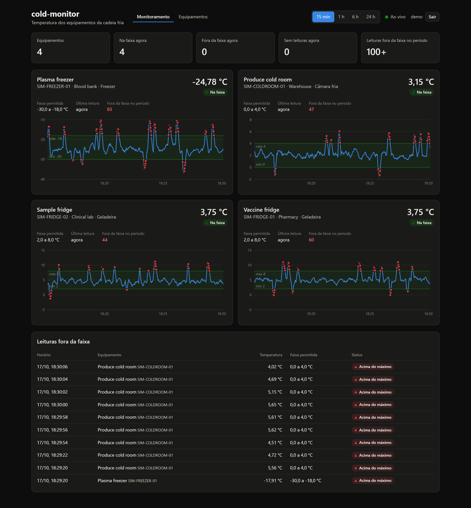
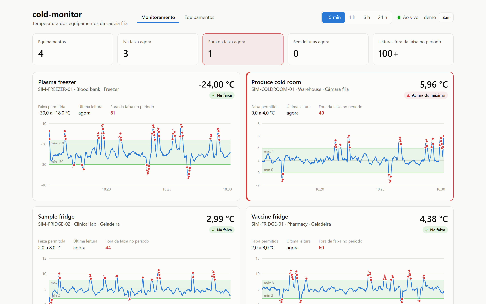

# cold-monitor-dashboard

[English](#english) · [Português (Brasil)](#português-brasil)

---

## English

Web dashboard for **cold-monitor**, a cold-chain temperature monitoring system. It shows every active piece of
equipment registered in the [cold-monitor backend](https://github.com/carloslpv/cold-monitor-backend) with its current
temperature and status, a temperature chart against its allowed range, and the readings that fell out of range. It
updates live as readings arrive, with no page refresh.



The architecture diagram and an overview of the whole system are in
[cold-monitor-infra](https://github.com/carloslpv/cold-monitor-infra).

### What it shows

- **Summary**: how many pieces of equipment are monitored, how many are in range or out of range right now, how many
  have stopped sending readings, and how many out-of-range readings happened in the selected period.
- **One panel per equipment**: current temperature with its status (`Na faixa`, `Acima do máximo`, `Abaixo do mínimo`),
  allowed range, time since the last reading and out-of-range count.
  The chart draws the temperature over the selected period on top of the allowed band, with out-of-range readings
  marked as red dots. Hover a point to see its time, value and status. A panel turns red while its latest reading is
  out of range.
- **Offline sensors**: when the backend flags an equipment as offline (no readings for `ALERT_OFFLINE_AFTER`, 5 minutes
  by default), its panel turns amber, shows a *Sem leituras* badge with the last known temperature, and marks the last
  reading time as *sem sinal*. It goes back to normal as soon as a reading arrives.
- **Out-of-range readings**: the latest 100 out-of-range readings across all equipment, newest first.
- **Period**: 15 minutes, 1 hour, 6 hours or 24 hours.



### Login

The dashboard opens on a login form; the user and password are the backend's `ADMIN_USERNAME` and `ADMIN_PASSWORD`.
Logging in starts a session kept in an HTTP-only cookie, which also authorizes the live stream, and the header shows
the user with a **Sair** button to log out. Requests that change data send the CSRF token the backend keeps in the
`XSRF-TOKEN` cookie. If the session ends (it expired, or someone logged out in another tab), the next request or stream
reconnection brings the login form back with a notice. Sessions survive backend restarts, so a monitor left open on a
screen stays logged in.

Someone logged in with the backend's read-only account (`VIEWER_USERNAME`, used by the public demo) sees everything,
but the **Equipamentos** page hides the buttons to register, edit, deactivate and reactivate.

### Managing equipment

The **Equipamentos** tab (`#/equipamentos`) lists all equipment, active and inactive, and lets you:

- **Register** equipment with code, name, location, type and the allowed temperature range.
- **Edit** any of these, including the range. New limits apply to readings from then on; stored readings keep the
  limits they were checked against.
- **Deactivate** equipment (after a confirmation): it leaves the monitor, stops accepting readings and no longer raises
  alerts. Its history is kept and it can be **reactivated** later.

The form checks the same rules as the backend before sending: code and name are required (up to 50 and 120
characters), temperatures accept a comma or a dot with up to two decimals between -100 and 100 °C, and the minimum must
be lower than the maximum. A code already in use is reported on the code field.

Changes made anywhere (another browser, the API) reach every open dashboard through the live stream's `equipment`
event, so the monitor picks up new ranges and activated or deactivated equipment without a reload.

Status is always shown with an icon and a label, not by color alone. The interface is in Brazilian Portuguese and
follows the system light or dark theme.

### How it stays live

On load the dashboard fetches the equipment list, the reading history of each piece of equipment for the selected
period, the recent out-of-range readings and the equipment currently offline (`GET /api/v1/sensor-outages?open=true`)
from the REST API. It then opens the backend's Server-Sent Events stream (`GET /api/v1/readings/stream`), appends each
new reading as it arrives and follows the `sensor-outage` events that mark equipment offline and back online. If the
connection drops, the indicator in the header switches to *Reconectando…*; once it is back, the history is reloaded so nothing stored meanwhile is missed.

Long periods can hold many thousands of readings, so each chart keeps the lowest and highest point of each time slice
(about 600 points in total). Short excursions past a threshold stay visible.

### Technical decisions

- **`EventSource` instead of a WebSocket library.** The dashboard only listens; every change it makes is a REST call.
  The browser's built-in `EventSource` reconnects on its own and sends the session cookie, so live updates need no
  dependency and no token handling. Events missed while disconnected are not replayed, so after a reconnect the
  history is reloaded and merged with what streamed in meanwhile, without duplicates.
- **Same origin in production.** The Docker image serves the page with nginx and proxies `/api` (stream included, with
  buffering off), so the browser never makes a cross-origin call and the session cookie stays `SameSite=Lax`. Only the
  Vite dev server talks to the backend across origins.
- **Min/max downsampling.** A 24-hour window can hold tens of thousands of readings per equipment. Each chart keeps the
  lowest and highest point of each time bucket (about 600 points), so drawing stays fast and a short excursion past a
  threshold is never averaged away.
- **No state library.** One hook (`useMonitor`) owns the data: initial REST load, live stream, reconnection and the
  per-equipment reading lists. React state and a few small hooks are enough for one page, and keep the bundle small.
- **Status is never color alone.** Every status has an icon and a label, panels follow the system light or dark theme,
  and forms check the same rules as the backend before sending, showing the backend's per-field errors when it still
  refuses.

### Stack

- React 19 and TypeScript 6
- Vite 8
- [Recharts](https://recharts.org) 3 for the charts
- Oxlint

### Requirements

- Node.js 20.19+ or 22.12+
- The cold-monitor backend running (see its README). It allows requests from `http://localhost:5173`, with the
  session cookie, by default.
- Optionally, the [cold-monitor simulator](https://github.com/carloslpv/cold-monitor-simulator) to generate readings.

### Running

```bash
npm install
npm run dev
```

Open `http://localhost:5173`. To see data move, start the backend and the simulator, for example:

```bash
java -jar target/cold-monitor-simulator.jar --api-key <DEVICE_API_KEY> --interval 1s --excursion-probability 0.05
```

### Configuration

| Variable | Default | Description |
| --- | --- | --- |
| `VITE_API_URL` | `http://localhost:8080` | Backend base URL. Empty means the page's own origin (used by the Docker image) |

Set it in a `.env.local` file (see `.env.example`) or in the environment when running `npm run dev` or `npm run build`.
If the dashboard is served from an origin other than `http://localhost:5173`, add that origin to the backend's
`CORS_ALLOWED_ORIGINS`.

### Docker

The `Dockerfile` builds the dashboard and serves it with nginx on port 80. nginx also forwards `/api` (including the
live stream, without buffering) to the backend at `BACKEND_URL` (default `http://backend:8080`), so the browser talks
to a single origin and CORS is not involved:

```bash
docker build -t cold-monitor-dashboard .
docker run -p 8090:80 -e BACKEND_URL=http://host.docker.internal:8080 cold-monitor-dashboard
```

To run the whole system (database, backend, dashboard) around the clock, use the compose file in
[cold-monitor-infra](https://github.com/carloslpv/cold-monitor-infra).

### Continuous integration

GitHub Actions (`.github/workflows/ci.yml`) runs lint and build and builds the Docker image on every push and pull
request.

### Scripts

| Command | Description |
| --- | --- |
| `npm run dev` | Development server on port 5173 |
| `npm run build` | Type-check and build to `dist/` |
| `npm run preview` | Serve the production build locally |
| `npm run lint` | Lint with Oxlint |

### Project layout

```
src
├── App.tsx          page layout, navigation and period selection
├── components       header, summary, equipment panel, chart, out-of-range table, status badge,
│                    equipment management (list, form, dialog)
├── hooks            login session (useAuth), data loading and live stream (useMonitor), current page, clock,
│                    chart colors
└── lib              API client, types, formatting, downsampling, equipment form validation
nginx                nginx config of the Docker image
```

---

## Português (Brasil)

Dashboard web do **cold-monitor**, um sistema de monitoramento de temperatura da cadeia fria. Ele mostra todos os
equipamentos ativos cadastrados no [backend do cold-monitor](https://github.com/carloslpv/cold-monitor-backend) com a
temperatura e o status atuais, um gráfico de temperatura com a faixa permitida e as leituras que ficaram fora da faixa.
Tudo é atualizado ao vivo conforme as leituras chegam, sem recarregar a página.


O diagrama de arquitetura e a visão geral do sistema inteiro estão no
[cold-monitor-infra](https://github.com/carloslpv/cold-monitor-infra).

### O que aparece

- **Resumo**: quantos equipamentos são monitorados, quantos estão na faixa ou fora dela agora, quantos pararam de
  enviar leituras e quantas leituras fora da faixa aconteceram no período escolhido.
- **Um painel por equipamento**: temperatura atual com o status (`Na faixa`, `Acima do máximo`, `Abaixo do mínimo`),
  faixa permitida, tempo desde a última leitura e quantidade de leituras fora da faixa. O gráfico mostra a temperatura no período sobre a faixa permitida, com as leituras fora da
  faixa marcadas em vermelho. Passe o mouse sobre um ponto para ver horário, valor e status. O painel fica vermelho
  enquanto a última leitura estiver fora da faixa.
- **Sensores sem leituras**: quando o backend marca um equipamento como offline (sem leituras há
  `ALERT_OFFLINE_AFTER`, 5 minutos por padrão), o painel fica âmbar, mostra o selo *Sem leituras* com a última
  temperatura conhecida e marca o horário da última leitura como *sem sinal*. Ele volta ao normal assim que uma leitura
  chega.
- **Leituras fora da faixa**: as 100 leituras fora da faixa mais recentes de todos os equipamentos.
- **Período**: 15 minutos, 1 hora, 6 horas ou 24 horas.


### Login

O dashboard abre num formulário de login; o usuário e a senha são o `ADMIN_USERNAME` e o `ADMIN_PASSWORD` do backend.
Entrar abre uma sessão guardada num cookie HTTP-only, que também autoriza o fluxo ao vivo, e o topo mostra o usuário
com um botão **Sair**. As requisições que alteram dados enviam o token de CSRF que o backend guarda no cookie
`XSRF-TOKEN`. Se a sessão acabar (expirou, ou alguém saiu em outra aba), a próxima requisição ou reconexão do fluxo
traz o formulário de login de volta com um aviso. As sessões sobrevivem a reinícios do backend, então um monitor
deixado aberto numa tela continua logado.

Quem entra com a conta só de leitura do backend (`VIEWER_USERNAME`, usada na demo pública) vê tudo, mas a página
**Equipamentos** não mostra os botões de cadastrar, editar, desativar e reativar.

### Gestão de equipamentos

A aba **Equipamentos** (`#/equipamentos`) lista todos os equipamentos, ativos e inativos, e permite:

- **Cadastrar** um equipamento com código, nome, local, tipo e a faixa de temperatura permitida.
- **Editar** qualquer um desses dados, inclusive a faixa. Os limites novos valem para as leituras daí em diante; as
  leituras gravadas mantêm os limites com que foram avaliadas.
- **Desativar** um equipamento (depois de uma confirmação): ele sai do monitoramento, deixa de aceitar leituras e não
  gera mais alertas. O histórico é mantido e ele pode ser **reativado** depois.

O formulário confere as mesmas regras do backend antes de enviar: código e nome são obrigatórios (até 50 e 120
caracteres), as temperaturas aceitam vírgula ou ponto com até duas casas decimais entre -100 e 100 °C, e a mínima
precisa ser menor que a máxima. Um código já usado é apontado no campo do código.

Mudanças feitas em qualquer lugar (outro navegador, a API) chegam a todos os dashboards abertos pelo evento
`equipment` do fluxo ao vivo, então o monitoramento pega faixas novas e equipamentos ativados ou desativados sem
recarregar a página.

O status sempre aparece com ícone e texto, não só pela cor. A interface é em português e acompanha o tema claro ou
escuro do sistema.

### Como fica ao vivo

Ao abrir, o dashboard busca na API REST a lista de equipamentos, o histórico de leituras de cada um no período
escolhido, as leituras fora da faixa recentes e os equipamentos offline no momento
(`GET /api/v1/sensor-outages?open=true`). Depois abre o fluxo de Server-Sent Events do backend
(`GET /api/v1/readings/stream`), acrescenta cada leitura nova assim que ela chega e acompanha os eventos
`sensor-outage`, que marcam quando um equipamento fica offline e quando volta. Se a conexão cair, o indicador no
topo muda para *Reconectando…*; quando ela volta, o histórico é recarregado para não perder nada que tenha sido gravado
nesse meio-tempo.

Períodos longos podem ter milhares de leituras, então cada gráfico mantém o menor e o maior ponto de cada intervalo de
tempo (cerca de 600 pontos no total). Excursões curtas além dos limites continuam visíveis.

### Decisões técnicas

- **`EventSource` em vez de uma biblioteca de WebSocket.** O dashboard só escuta; toda alteração que ele faz é uma
  chamada REST. O `EventSource` nativo do navegador reconecta sozinho e envia o cookie de sessão, então as atualizações
  ao vivo não precisam de dependência nem de controle de token. Eventos perdidos durante uma desconexão não são
  reenviados, então depois de reconectar o histórico é recarregado e mesclado com o que chegou pelo fluxo nesse
  meio-tempo, sem duplicatas.
- **Mesma origem em produção.** A imagem Docker serve a página com nginx e repassa `/api` (inclusive o fluxo, com o
  buffer desligado), então o navegador nunca faz chamada entre origens e o cookie de sessão fica `SameSite=Lax`. Só o
  servidor de desenvolvimento do Vite fala com o backend em outra origem.
- **Redução de pontos por mínimo e máximo.** Uma janela de 24 horas pode ter dezenas de milhares de leituras por
  equipamento. Cada gráfico guarda o ponto mais baixo e o mais alto de cada intervalo de tempo (cerca de 600 pontos),
  então o desenho continua rápido e uma excursão curta além do limite nunca some numa média.
- **Sem biblioteca de estado.** Um hook (`useMonitor`) é dono dos dados: carga inicial pelo REST, fluxo ao vivo,
  reconexão e as listas de leituras por equipamento. O estado do React e alguns hooks pequenos bastam para uma página,
  e mantêm o bundle pequeno.
- **Status nunca só por cor.** Todo status tem ícone e texto, os painéis seguem o tema claro ou escuro do sistema e os
  formulários verificam as mesmas regras do backend antes de enviar, mostrando os erros por campo do backend quando ele
  ainda recusa.

### Tecnologias

- React 19 e TypeScript 6
- Vite 8
- [Recharts](https://recharts.org) 3 nos gráficos
- Oxlint

### Requisitos

- Node.js 20.19+ ou 22.12+
- O backend do cold-monitor rodando (veja o README dele). Por padrão ele aceita requisições de
  `http://localhost:5173`, com o cookie de sessão.
- Opcionalmente, o [simulador do cold-monitor](https://github.com/carloslpv/cold-monitor-simulator) para gerar leituras.

### Como rodar

```bash
npm install
npm run dev
```

Abra `http://localhost:5173`. Para ver os dados se mexendo, suba o backend e o simulador, por exemplo:

```bash
java -jar target/cold-monitor-simulator.jar --api-key <DEVICE_API_KEY> --interval 1s --excursion-probability 0.05
```

### Configuração

| Variável | Padrão | Descrição |
| --- | --- | --- |
| `VITE_API_URL` | `http://localhost:8080` | URL base do backend. Vazio significa a própria origem da página (usado na imagem Docker) |

Defina em um arquivo `.env.local` (veja o `.env.example`) ou no ambiente ao rodar `npm run dev` ou `npm run build`.
Se o dashboard for servido de outra origem que não `http://localhost:5173`, adicione essa origem em
`CORS_ALLOWED_ORIGINS` no backend.

### Docker

O `Dockerfile` gera o build do dashboard e serve com o nginx na porta 80. O nginx também repassa `/api` (inclusive o
fluxo ao vivo, sem buffer) para o backend em `BACKEND_URL` (padrão `http://backend:8080`), então o navegador fala com
uma única origem e o CORS não entra em jogo:

```bash
docker build -t cold-monitor-dashboard .
docker run -p 8090:80 -e BACKEND_URL=http://host.docker.internal:8080 cold-monitor-dashboard
```

Para rodar o sistema inteiro (banco, backend e dashboard) 24 horas por dia, use o compose do
[cold-monitor-infra](https://github.com/carloslpv/cold-monitor-infra).

### Integração contínua

O GitHub Actions (`.github/workflows/ci.yml`) roda o lint e o build e gera a imagem Docker a cada push e pull request.

### Scripts

| Comando | Descrição |
| --- | --- |
| `npm run dev` | Servidor de desenvolvimento na porta 5173 |
| `npm run build` | Verifica os tipos e gera o build em `dist/` |
| `npm run preview` | Serve o build de produção localmente |
| `npm run lint` | Lint com o Oxlint |

### Estrutura do projeto

```
src
├── App.tsx          layout da página, navegação e escolha do período
├── components       cabeçalho, resumo, painel do equipamento, gráfico, tabela de fora da faixa, selo de status,
│                    gestão de equipamentos (lista, formulário, diálogo)
├── hooks            sessão de login (useAuth), carga de dados e fluxo ao vivo (useMonitor), página atual,
│                    relógio, cores do gráfico
└── lib              cliente da API, tipos, formatação, redução de pontos, validação do formulário de equipamento
nginx                configuração do nginx da imagem Docker
```
